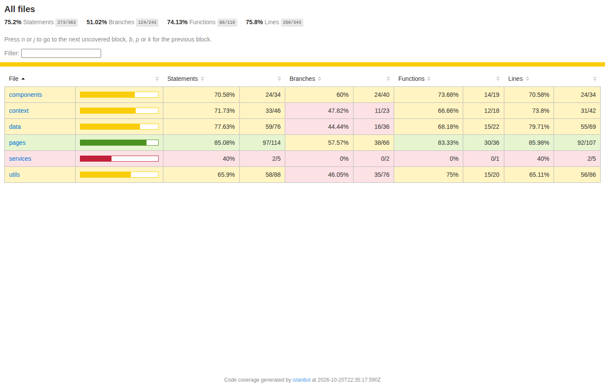
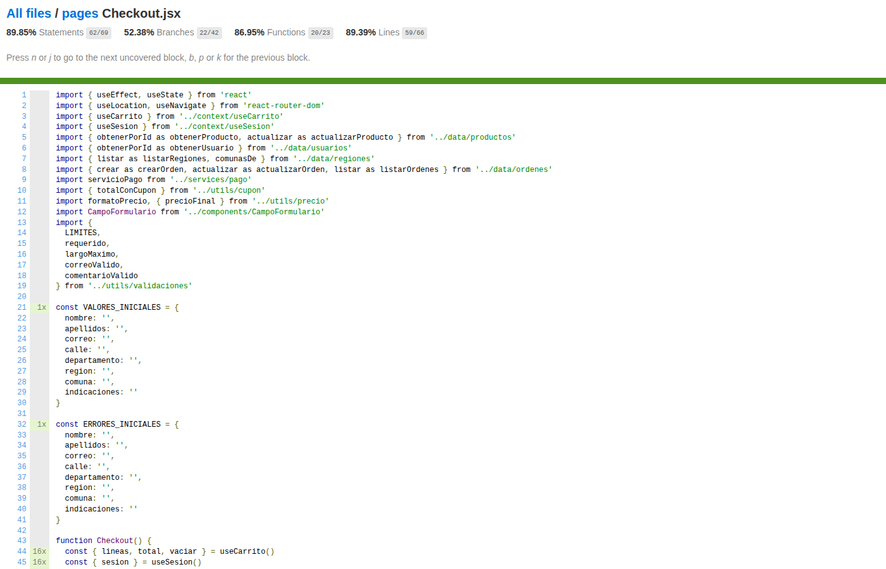

# Documento de Cobertura de Testing — PetShop Chile (V2.1)

**Proyecto:** PetShop Chile — React + Vite
**Fecha:** 20/10/2026
**Comando de ejecución:** `npm test` (dentro de `react-app/`)
**Resultado:** 18/18 pruebas en verde

---

## 1. Alcance

### 1.1 Qué se probó

Las 18 pruebas cubren los módulos críticos del flujo de compra y sus bases (24 archivos instrumentados por `babel-plugin-istanbul`: los que el grafo de webpack de los specs alcanza a importar):

| Módulo | Archivo | Qué se cubre |
|--------|---------|--------------|
| Componente | `src/components/TarjetaProducto.jsx` | Render de nombre y precio, evento del botón Añadir, condición sin stock |
| Componente | `src/components/RutaProtegida.jsx` | Redirección al login sin sesión (rama pública) |
| Componente | `src/components/ResumenCarrito.jsx` | Aplicar un cupón actualiza el total mostrado |
| Componente | `src/components/CampoFormulario.jsx` | Render de input, etiqueta y estado (usado indirectamente por Login y Checkout) |
| Componente | `src/components/ListadoProductos.jsx` | Listado y botones de las tarjetas (usado por Productos) |
| Página | `src/pages/Login.jsx` | Error condicional, cambio de estado del formulario, envío con mock del contexto |
| Página | `src/pages/Productos.jsx` | El filtro por texto reduce la lista de productos |
| Página | `src/pages/Checkout.jsx` | Pago aprobado (orden pagada, stock descontado) y rechazada (orden fallida con motivo) |
| Contexto | `src/context/CarritoProvider.jsx` | `agregar()` con suma de cantidad (RN-04), persistencia en `localStorage` |
| Contexto | `src/context/*Context.js`, `use*.js` | Creación de contextos y hooks |
| Datos | `src/data/repositorio.js` | CRUD completo (`crear`, `actualizar`, `eliminar`) sobre `localStorage` |
| Datos | `src/data/productos.js`, `regiones.js`, `ordenes.js`, `usuarios.js`, `categorias.js` | Semillas y lecturas usadas por los specs |
| Utilidades | `src/utils/validaciones.js` | `runValido`, `correoValido`, `contrasenaValida`, `fechaNoFutura` (con `jasmine.clock`) |
| Utilidades | `src/utils/cupon.js` | `BIENVENIDO10`, `PETSHOP20` y cupón inválido |
| Utilidades | `src/utils/precio.js` | `precioFinal` con y sin oferta, `formatoPrecio` |
| Servicio | `src/services/pago.js` | Simulado con `spyOn` en Checkout (aprobado y rechazado) |

### 1.2 Qué no se probó

- **Panel administrativo:** AdminLayout, Dashboard, OrdenesAdmin, DetalleOrdenAdmin, ProductosAdmin, ProductoNuevo/Editar, CategoriasAdmin, CategoriaNueva/Editar, UsuariosAdmin, UsuarioNuevo/Editar, HistorialCompras, Reportes y Perfil.
- **Vistas informativas de la tienda:** Home, DetalleProducto, Categorias, Ofertas, Registro, Contacto, Nosotros, Blogs, DetalleBlog y NotFound.
- **Componentes y módulos de apoyo:** Header, Footer, LineaCarrito, TarjetaCategoria, DetalleOrden, los formularios del panel (`FormularioProducto/Usuario/Categoria`), `utils/cupon.js` (solo la capa de lógica, no su UI en CarritoPage) y las ramas de error de `App.jsx`.

El alcance se priorizó sobre el flujo de compra completo (carrito → cupón → checkout → pago → orden), la sesión, la validación y la persistencia, que son los requisitos con reglas de negocio explícitas (RN-01 a RN-11). Las secciones de la app fuera de ese flujo quedan como mejora propuesta en la sección 5.

## 2. Herramientas y cómo ejecutarlas

| Herramienta | Versión instalada | Para qué |
|-------------|-------------------|----------|
| Karma | 6.4.4 | Orquesta el entorno: carga los specs en el navegador y reporta resultados. |
| jasmine-core (Jasmine) | 4.6.1 | Framework de pruebas: `describe`, `it`, `expect`, `beforeEach`, espías, `jasmine.clock`. Es la versión que usa `karma-jasmine` (queda deduplicada en el árbol de npm). |
| karma-jasmine | 5.1.0 | Adaptador entre Karma y Jasmine. |
| karma-chrome-launcher | 3.2.0 | Lanza ChromeHeadless (launcher propio `ChromeHeadlessNoSandbox`). |
| karma-coverage | 2.2.1 | Reporte de cobertura (HTML, text-summary, lcov) desde `window.__coverage__`. |
| karma-webpack + webpack | 5.0.1 / 5.112.0 | Compila los specs JSX en el navegador (Vite no se integra con Karma). |
| babel-loader + @babel/core, preset-env, preset-react | 10.1.1 / 8.0.7, 8.0.7, 8.0.1 | Transpila JSX/ESM; `babel-plugin-istanbul` 8 instrumenta el código para cobertura. |
| @testing-library/react + @testing-library/dom | 16.3.3 / 10.4.2 | Render de componentes React y consulta/disparo de eventos (`render`, `screen`, `fireEvent`, `findByText`). |
| Puppeteer | 25.14.0 | Descarga el Chrome for Testing usado como binario (`CHROME_BIN` en `karma.conf.js`). |

**Cómo ejecutar:**

```bash
cd react-app
npm install   # primera vez
npm test      # = karma start karma.conf.js --single-run
```

Salida esperada: `TOTAL: 18 SUCCESS` más el resumen de cobertura. El reporte HTML queda en `react-app/coverage/html/index.html` (abrirlo en el navegador) y los datos crudos en `react-app/coverage/lcov/lcov.info`.

**Configuración clave:**
- `karma.conf.js`: frameworks `jasmine`; archivos `src/**/*.spec.jsx`; preprocesador `webpack`; reporters `progress` y `coverage`; salida `coverage/`; navegador `ChromeHeadlessNoSandbox`.
- `webpack.test.config.js`: `mode: development`, `inline-source-map`, babel-loader con istanbul solo en test, reglas para CSS e imágenes, `resolve.fullySpecified: false` (por `"type": "module"` del package.json).

## 3. Tabla de pruebas (18)

| # | Archivo spec | Componente / módulo | Qué verifica | Tipo | Concepto clave |
|---|--------------|---------------------|--------------|------|----------------|
| 1 | `TarjetaProducto.spec.jsx` | TarjetaProducto | Muestra el nombre del producto y el precio formateado ("$4.990") | Renderizado | props, `formatoPrecio` |
| 2 | `TarjetaProducto.spec.jsx` | TarjetaProducto | Al pulsar "Añadir" llama a `onAgregar` con el id del producto | Props y evento | `jasmine.createSpy`, `toHaveBeenCalledWith` |
| 3 | `TarjetaProducto.spec.jsx` | TarjetaProducto | Con stock 0 el botón queda deshabilitado y dice "Sin stock" | Renderizado condicional | `disabled` según props |
| 4 | `Login.spec.jsx` | Login | El mensaje de error aparece **solo** con credenciales inválidas | Renderizado condicional | `and.returnValue`, `queryByRole('alert')` |
| 5 | `Login.spec.jsx` | Login | Al escribir en el campo correo, el valor del input cambia | Estado | `fireEvent.change` |
| 6 | `Login.spec.jsx` | Login + contexto de sesión | Al enviar el formulario llama a `iniciarSesion(correo, clave)` | Evento con mock | `SesionContext.Provider` falso |
| 7 | `validaciones.spec.jsx` | `runValido()` | Acepta los 5 RUN de prueba y rechaza mal formados o con DV incorrecto | Unitaria | función pura, `withContext` |
| 8 | `validaciones.spec.jsx` | `correoValido()`, `contrasenaValida()` | Dominios permitidos, formato y largo de clave | Unitaria | función pura |
| 9 | `validaciones.spec.jsx` | `fechaNoFutura()` | Con el reloj fijado al 20/10/2026 acepta el 19 y rechaza el 21 | Unitaria + reloj | `jasmine.clock().install()`, `mockDate` |
| 10 | `cupon.spec.jsx` | `buscarCupon()`, `totalConCupon()` | BIENVENIDO10 (-10%), PETSHOP20 (-20%) y cupón inválido (`null`) | Unitaria | funciones puras |
| 11 | `precio.spec.jsx` | `precioFinal()` | Descuenta la oferta (20%) o devuelve el precio sin oferta | Unitaria | función pura |
| 12 | `repositorio.spec.jsx` | `crearRepositorio()` | `crear` (id = máx + 1), `actualizar` y `eliminar` sobre `localStorage` mockeado | Unitaria + mock | CRUD, `Map` en memoria |
| 13 | `CarritoProvider.spec.jsx` | CarritoProvider | Agregar dos veces el mismo producto suma la cantidad (RN-04) y persiste | Estado + mock | `spyOn(Storage.prototype, …)`, `act()` |
| 14 | `RutaProtegida.spec.jsx` | RutaProtegida | Sin sesión redirige a `/login` y no renderiza el panel | Renderizado condicional | `MemoryRouter`, `Navigate` |
| 15 | `ResumenCarrito.spec.jsx` | ResumenCarrito | Aplicar BIENVENIDO10 cambia el total de $10.000 a $9.000 | Estado + evento | envoltura con `useState`, `fireEvent` |
| 16 | `Productos.spec.jsx` | Productos | Escribir "croquetas" en el buscador reduce la lista de 3 a 1 | Render + evento | filtro por texto de `FiltrosProductos` |
| 17 | `Checkout.spec.jsx` | Checkout + pago | Pago aprobado: navega a `/pago-correcto/ORD-0001`, orden "pagada" y stock descontado | Integración + mock | `spyOn(servicioPago, 'procesarPago')`, `findByText` |
| 18 | `Checkout.spec.jsx` | Checkout + pago | Pago rechazado: navega a `/pago-error/ORD-0001`, orden "fallida" con motivo | Integración + mock | `spyOn` con `and.returnValue`, RN-11 |

Todas siguen el patrón **preparar → actuar → verificar** (`render` con sus mocks → `fireEvent` → `expect`).

## 4. Resultados de cobertura

### 4.1 Captura 1 — Resumen de la ejecución (`npm test`)

```
Chrome Headless 155.0.0.0 (Linux 0.0.0): Executed 18 of 18 SUCCESS (0 secs / 0.18 secs)
TOTAL: 18 SUCCESS

=============================== Coverage summary ===============================
Statements   : 75.2%  ( 273/363 )
Branches     : 51.02% ( 124/243 )
Functions    : 74.13% ( 86/116 )
Lines        : 75.8%  ( 260/343 )
===============================================================================
```

### 4.2 Captura 2 — Reporte HTML

Vista general del reporte (`react-app/coverage/html/index.html`), generada por istanbul:



Detalle de `Checkout.jsx` (una de las páginas más cubiertas, 89,4% de líneas):



Las capturas están en `docs/capturas/`. El reporte HTML completo se genera con `npm test` en `react-app/coverage/html/index.html`.

### 4.3 Resultado por archivo (extraído de `coverage/lcov/lcov.info`)

| Archivo | Líneas | Funciones | Branches |
|---------|--------|-----------|----------|
| `utils/cupon.js` | 100% (9/9) | 100% (2/2) | 83,3% (5/6) |
| `utils/precio.js` | 80% (4/5) | 100% (2/2) | 75% (3/4) |
| `utils/validaciones.js` | 59,7% (43/72) | 68,8% (11/16) | 40,9% (27/66) |
| `services/pago.js` | 40% (2/5) | 0% (0/1) | 0% (0/2) |
| `data/repositorio.js` | 90% (36/40) | 100% (12/12) | 78,6% (11/14) |
| `data/productos.js` | 100% (3/3) | — | — |
| `data/regiones.js` | 100% (7/7) | 100% (3/3) | 83,3% (5/6) |
| `data/ordenes.js` | 60% (3/5) | 0% (0/2) | 0% (0/4) |
| `data/usuarios.js` | 27,3% (3/11) | 0% (0/5) | 0% (0/12) |
| `data/categorias.js` | 100% (3/3) | — | — |
| `context/CarritoProvider.jsx` | 71,9% (23/32) | 62,5% (10/16) | 47,4% (9/19) |
| `context/useCarrito.js` | 75% (3/4) | 100% (1/1) | 50% (1/2) |
| `context/useSesion.js` | 75% (3/4) | 100% (1/1) | 50% (1/2) |
| `context/CarritoContext.js` | 100% (1/1) | — | — |
| `context/SesionContext.js` | 100% (1/1) | — | — |
| `pages/Checkout.jsx` | 89,4% (59/66) | 87% (20/23) | 52,4% (22/42) |
| `pages/Login.jsx` | 77,8% (21/27) | 88,9% (8/9) | 68,8% (11/16) |
| `pages/Productos.jsx` | 85,7% (12/14) | 50% (2/4) | 62,5% (5/8) |
| `components/TarjetaProducto.jsx` | 100% (5/5) | 100% (2/2) | 66,7% (4/6) |
| `components/ResumenCarrito.jsx` | 100% (3/3) | 100% (2/2) | 80% (4/5) |
| `components/CampoFormulario.jsx` | 83,3% (5/6) | 66,7% (4/6) | 77,8% (14/18) |
| `components/ListadoProductos.jsx` | 66,7% (4/6) | 66,7% (2/3) | 33,3% (1/3) |
| `components/FiltrosProductos.jsx` | 60% (3/5) | 60% (3/5) | — |
| `components/RutaProtegida.jsx` | 44,4% (4/9) | 100% (1/1) | 12,5% (1/8) |
| **TOTAL** | **75,8% (260/343)** | **74,13% (86/116)** | **51% (124/243)** |

Nota: solo aparecen los archivos que el grafo de los specs alcanza a importar; los demás (páginas del panel, layouts, etc.) no están instrumentados y no suman al total.

## 5. Análisis

### Qué quedó sin cubrir y por qué

1. **Panel administrativo y vistas informativas:** priorizamos el flujo de compra completo y las bases compartidas (repositorio, validaciones, contextos); el panel se dejó para specs específicos porque cada página depende de varios módulos de datos a la vez.
2. **`data/usuarios.js` (27,3% de líneas):** los specs de Login mockean el contexto de sesión, así que no se ejecutan `buscarPorCorre…`, `buscarPorCredenciales` ni la siembra real de usuarios.
3. **`utils/validaciones.js` (59,7%):** quedan sin probar `telefonoValido`, `direccionValida`, `precioValido`, `enteroNoNegativo` y las ramas vacías de `largoMaximo`/`largoEntre`.
4. **Branches globales al 51%:** la mayor parte corresponde a los `catch` de `localStorage`/`sessionStorage` (storage dañado o cuota llena) y a los props con valor por defecto (`deshabilitado = false`, `mensajeVacio`).
5. **`services/pago.js` (40%):** en Checkout se sustituye con `spyOn`, por eso la función real solo se ejecuta en la siembra de otros specs; se podría cubrir con un spec unitario directo del servicio.

### Qué mejorarías

- Specs de `ProductosAdmin` (eliminar con `window.confirm` mockeado y refresco del listado) y de `FormularioProducto`/`FormularioUsuario` (props `valoresIniciales`/`onGuardar`, RN-10).
- Spec de `services/pago.js` que ejecute la función real con total bajo y sobre el tope de $100.000 (RN-11) sin mock.
- Ramas de error de `repositorio.js` con `getItem` devolviendo JSON corrupto (`'{'`).
- Meta a futuro: ≥ 85% en sentencias agregando specs del panel y de CarritoPage.

## 6. Mocks usados y para qué

| Mock | Dónde | Para qué |
|------|-------|----------|
| `jasmine.createSpy('onAgregar')` | TarjetaProducto (prueba 2) | Escuchar el evento del botón sin depender de la implementación real; verificar cuántas veces se llamó y con qué argumento (el id). |
| `SesionContext.Provider` con `iniciarSesion: jasmine.createSpy()` | Login (pruebas 4, 5, 6) | Sustituir el `SesionProvider` real: aislar el componente de `sessionStorage` y de la búsqueda de usuarios, y controlar el resultado (`and.returnValue({ok: false…})`) para forzar el camino de error o de éxito. |
| `spyOn(Storage.prototype, 'getItem'/'setItem').and.callFake(…)` con un `Map` | CarritoProvider, Checkout, Productos, repositorio | Reemplazar el `localStorage` real por un almacén en memoria: aislamiento total entre pruebas, control de la semilla y verificación de lo que quedó persistido (orden creada, stock descontado). |
| `spyOn(servicioPago, 'procesarPago').and.returnValue({ok: true/false…})` | Checkout (pruebas 17 y 18) | Simular la pasarela de pago: se prueba el camino de éxito y el de rechazo sin depender del monto; `servicioPago` se exporta como objeto precisamente para poder espiarlo. |
| `jasmine.clock().install()` + `mockDate` | fechaNoFutura (prueba 9) | Fijar la fecha del navegador al 20/10/2026 para que la validación de "fecha no futura" sea determinista en cualquier máquina y zona horaria. |
| `MemoryRouter initialEntries={['/login']}` / `{['/checkout']}` / `{['/admin']}` | Login, RutaProtegida, Checkout | Simula la URL de la SPA sin necesidad de navegador real; permite verificar las redirecciones de `Navigate` y el cambio de ruta tras el pago. |
| `act()` y `findByText` de @testing-library/react | CarritoProvider, Checkout | `act()` aplica cambios de estado fuera de eventos; `findByText` espera a que React termine de pintar la ruta destino después de navegar. |

Ningún mock depende de implementaciones internas de React o de librerías de terceros; todos sustituyen límites del sistema (almacenamiento, sesión, ruteo, pago y espías de eventos), que es la recomendación del curso para pruebas estables.
